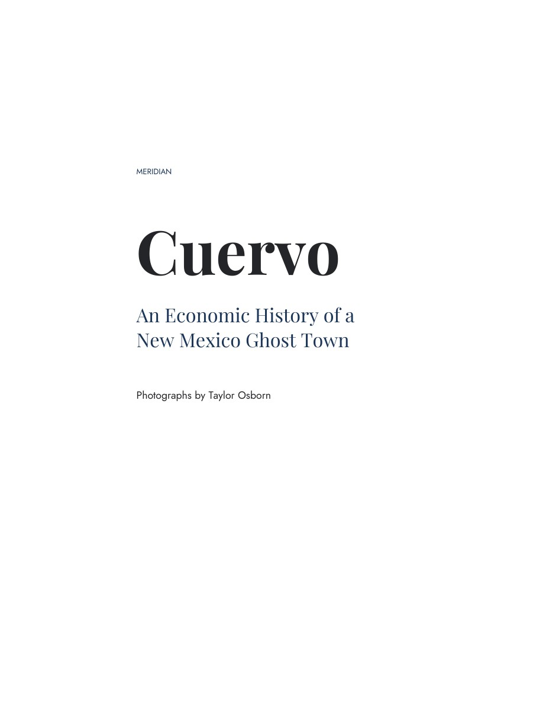

# Cuervo

## An Economic History of a New Mexico Ghost Town

A Meridian monograph, with photographs by Taylor Osborn. The book examines how trade, transport, schooling, and other services gathered at Cuervo, New Mexico, and how those functions contracted or moved while ranching continued in the surrounding country.

This repository contains the manuscript, research tables and transcriptions, figure assets, and production code. The current edition has eight chapters, 169 source notes, 18 photographs, and 148 print pages, including one final blank for duplex printing.

## Read the book

[**Download the book — 9.62 MB PDF**](https://github.com/trafaelosborn/cuervo/releases/download/v1.0.0/cuervo-monograph-compact.pdf) · [Full-quality print PDF — 42.09 MB](https://github.com/trafaelosborn/cuervo/releases/download/v1.0.0/cuervo-monograph-print-letter.pdf)

<a href="https://github.com/trafaelosborn/cuervo/releases/tag/v1.0.0"></a>

Both editions are available from the [first release](https://github.com/trafaelosborn/cuervo/releases/tag/v1.0.0):

| File | Use | Size |
| --- | --- | --- |
| `cuervo-monograph-print-letter.pdf` | Full-quality US Letter print edition | 42.09 MB |
| `cuervo-monograph-compact.pdf` | Sharing through services with a 9.8 MB limit | 9.62 MB |

Print at **Actual size / 100%**, in color, double-sided with **long-edge flipping**. The book uses 74 sheets. Both PDFs contain the approved subtitle and have identical text and pagination.

The files reproduce the October 21, 2026 edition. The GitHub release was assembled on October 26, 2026. Checksums are recorded in [the release manifest](releases/v1.0.0-files.json).

## Find the argument and evidence

| Material | Location |
| --- | --- |
| Current complete manuscript | [Monograph](manuscript/monograph/cuervo-complete-manuscript.md) |
| Current chapter sources | [Revision 10 chapters](manuscript/book-revision-10/chapters/) |
| Bibliography | [Sources and bibliography](manuscript/book-revision-10/bibliography.md) |
| Research reports, tables, and transcriptions | [Research evidence](research_evidence/) |
| Maps, charts, documentary excerpts, and photographs | [Figure assets](manuscript/figures/) |
| Source archive catalog and original links | [Archive guide](archive/README.md) |
| Build instructions | [Building the book](docs/building.md) |
| Rights and font licenses | [Rights](RIGHTS.md) |

The current monograph supersedes earlier drafts and interpretations in dated research notes. Earlier revisions are retained to document the development of the work; they are not alternative current editions.

## Rebuild or check the release

Use Python 3.12 and install `requirements.txt`, then run:

```sh
python tools/build.py
```

Add `--compact` to generate the smaller sharing copy. The build uses the included figure assets and bundled open fonts. Full census reels and other large source files are unnecessary for typesetting the current book; some historical acquisition and analysis scripts still require them. See [Building the book](docs/building.md) for details.

To verify downloaded release PDFs, place them in `output/pdf/` and run:

```sh
python tools/verify_release.py
```

## Repository scope

The large source archive remains in the author's local project archive. This repository catalogs those holdings and preserves published figure excerpts, source locators, and available original URLs. Private correspondence, contact details, temporary renders, caches, and generated historical PDFs are excluded.

The book and supporting materials are publicly available to read and inspect. No additional reuse license is granted for the writing, photographs, or project code. Existing third-party licenses and notices, including the bundled font licenses, remain applicable. See [Rights and reuse](RIGHTS.md).
